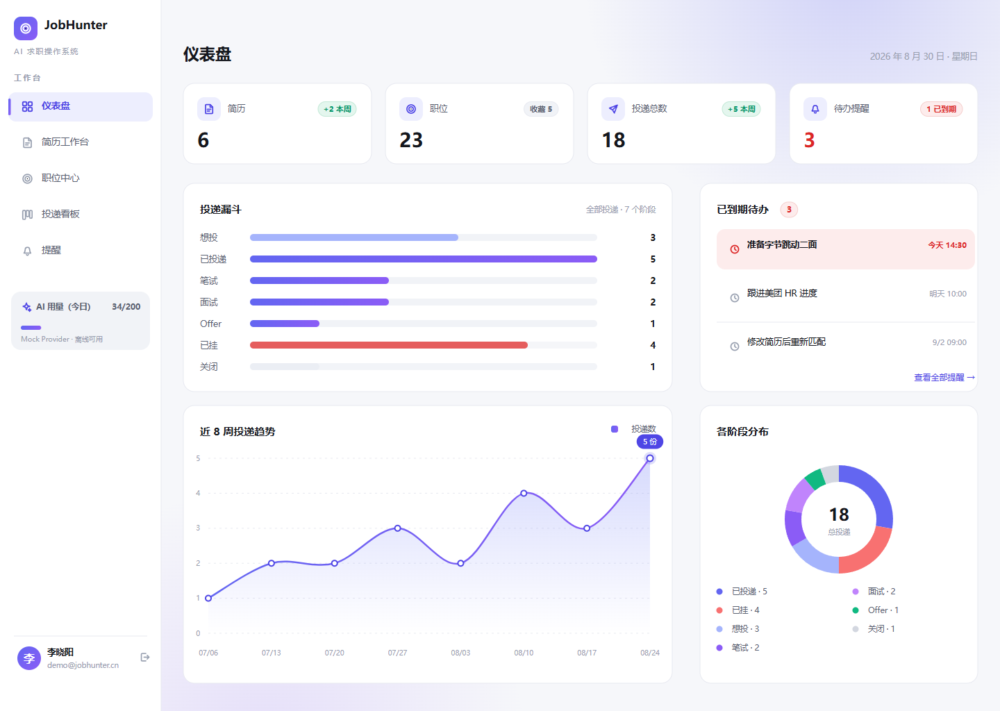
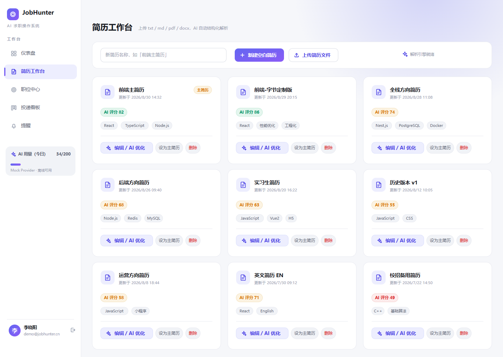
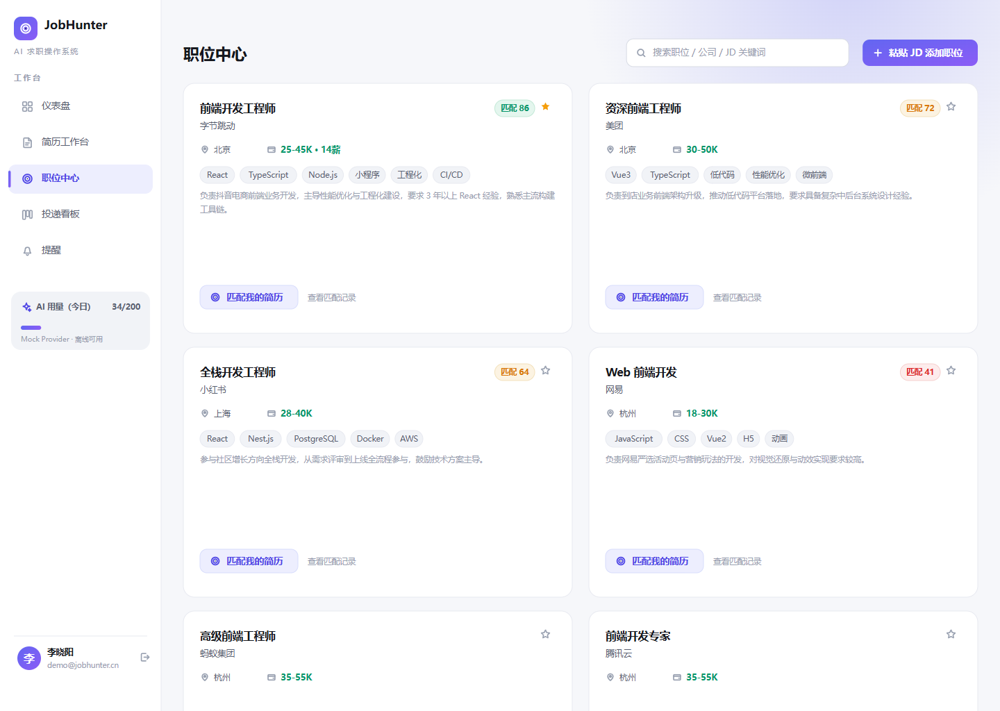
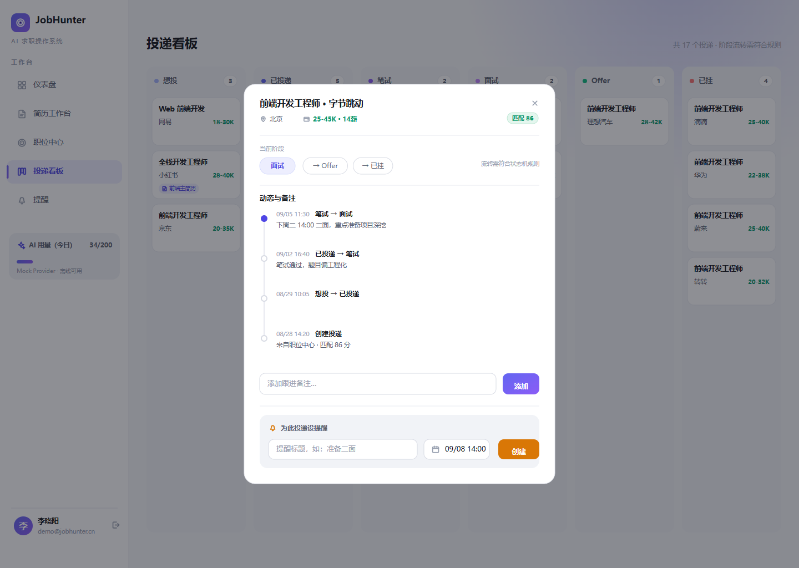
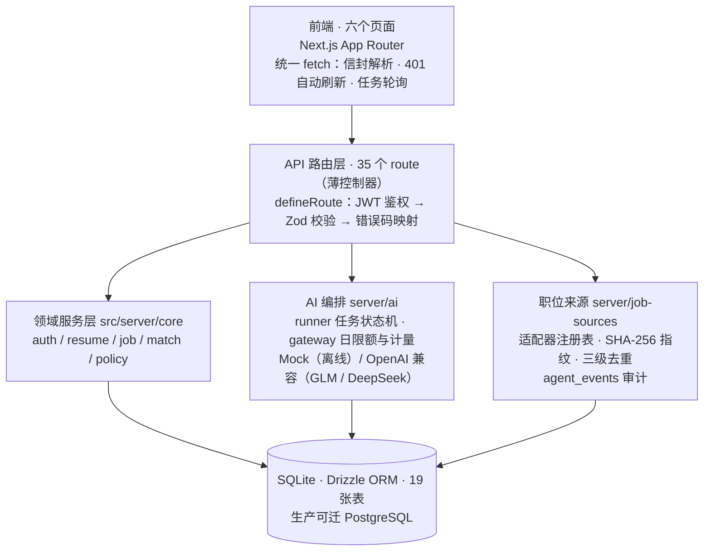

# JobHunter — 智能求职操作系统

<p align="center">
  <picture>
    <source media="(prefers-color-scheme: dark)" srcset="design/preview/dashboard.dark.png">
    
  </picture>
</p>

<p align="center">
  <strong>面向国内求职者的智能工作台：简历工作台 × 职位智能匹配 × 一键雷达找岗</strong>
</p>

<p align="center">
  
  
  
  
  
</p>

> ⚡ **装个 skill 即用（CLI 轻模式）**：不装依赖、不建数据库——把 [skills/](skills/README.md) 下的技能装进 Claude Code / ZCode，立刻获得**简历诊断 · JD 解析 · 岗位匹配（确定性评分）· 简历定制（带溯源）· 打招呼语 · 职位雷达（只读聚合）**六个轻场景，评分规则与防编造约束和 Web 版同源。进度持久化、职位雷达自动入库等完整能力，走下面的 Web OS。

> 💡 **零成本开箱即用**：默认内置**本地引擎（演示模式）**——无需任何 API Key 即可跑通全部功能；在「设置 → 自备模型」粘贴 Key（GLM / DeepSeek / Kimi / 通义等国产模型）即切换真实大模型。

## 📸 项目截图

| 简历工作台 | 职位中心 · 智能匹配 |
|---|---|
| <picture><source media="(prefers-color-scheme: dark)" srcset="design/preview/resumes.dark.png"></picture> | <picture><source media="(prefers-color-scheme: dark)" srcset="design/preview/jobs.dark.png"></picture> |

| 仪表盘 | 粘贴 JD 导入 |
|---|---|
| <picture><source media="(prefers-color-scheme: dark)" srcset="design/preview/dashboard.dark.png"></picture> | <picture><source media="(prefers-color-scheme: dark)" srcset="design/preview/app-modal.dark.png"></picture> |

> 概念稿渲染图（`design/figma/` 一键重建：`node design/figma/build.mjs`），实际界面已按此设计语言全站落地，支持深/浅色主题。

## 🚀 在线 Demo — 无需安装，1 分钟跑起来

点击按钮，在 GitHub 云端打开一个现成开发环境（用你自己的 GitHub 账号，免费额度足够）：

<p align="center">
  <a href="https://codespaces.new/ningrix/jobhunter?quickstart=1">
    
  </a>
</p>

环境就绪后（自动完成依赖安装和演示数据灌入），在 Codespaces 终端执行：

```bash
npm run dev
```

弹出端口 3000 预览后点击即可进入完整系统——数据库、智能引擎（本地引擎演示模式）全部可用，无需任何 API key、零成本。

本地运行同样三步：

```bash
npm install && npm run db:seed && npm run dev   # http://localhost:3000
```

## 🔑 演示账号

```
邮箱：demo@jobhunter.cn
密码：demo12345
```

> **本地单用户模式（开箱即用）**：`npm run dev` 本地开发默认免登录，启动后直接进入工作台（自动创建本地用户）。如需体验注册/登录流程，在 `.env` 设置 `AUTH_MODE=login` 即可恢复；生产部署始终强制登录。

已预置完整演示数据：1 份主简历、14 个职位、3 组预计算匹配。

## ⏱️ 3 分钟完成一次完整体验

| 步骤 | 去哪 | 做什么 | 你会看到 |
|---|---|---|---|
| **1** | 仪表盘 | 打开即用，无需登录 | 简历 / 职位总览 + 快捷入口 |
| **2** | 简历工作台 | 打开主简历 | 引擎结构化简历 + 诊断评分与优化建议，可逐条采纳 / 拒绝 / 编辑后采纳 |
| **3** | 职位中心 | 点「雷达扫描」多源自动入库，或粘贴一段 JD 自动解析；点「导出 Excel」随时带走 | 自动建档 + 五维规则评分 + 引擎「优势 / 差距 / 风险」结构化解读 |
| **4** | 职位中心 | 在职位卡上计算匹配分 | 用户自调「匹配偏好 · 权重向量」（设置页），归一化后走加权点积 |
| **5** | 官方招聘导航 | 按分类直达 140 家企业/平台官方招聘入口 | 已核对域名标「已验证」，其余标「待验证」；看中岗位回职位中心粘贴 JD 即可 |

> 全程智能功能由离线确定性本地引擎（Mock Provider）驱动，不需要配置任何模型。想接真模型：设置页选国产服务商（智谱 / DeepSeek / Kimi / 通义千问）只填一个 Key，AES-256-GCM 加密存储。

## 🏗️ 架构图

四层结构：页面层 → 薄控制器层 → 领域服务层 → 基础设施层；AI 编排、职位来源适配是与领域服务平行的两个能力域。



完整版（数据模型 ER 图、认证流程、AI 任务流、导入去重、匹配推荐共 8 张图）见 [14 架构与流程图](docs/14-架构与流程图.md)，交互版打开 `design/architecture.html`。

## 🧰 技术栈

Next.js 15 (App Router) · TypeScript · Tailwind CSS 4 · Drizzle ORM + SQLite（生产可切 PostgreSQL）· jose (JWT) · bcryptjs · Zod · ExcelJS（职位导出）· Vitest（261 用例 / 41 个测试文件）

## 🔩 核心实现

- **生产级任务运行时（V4.0）**：AI 任务从轮询升级为 **SSE 实时事件流**（`TaskEventBus` 进程内总线，接口对齐 BullMQ/Redis Pub/Sub 可插拔替换）——任务进度/阶段文案落库 + 推流双通道，前端 `streamTask` 订阅、断流自动回落轮询；配套 **AI 成本核算**（按模型价格表 token→元折算，环境变量可覆盖，`GET /api/v1/ai-usage` 汇总）与**存储抽象层**（`StorageService`：Local/OSS 驱动可切换，键格式向后兼容）

- **可解释的匹配引擎**：规则评分器（加权点积）+ 用户自调权重向量（归一化、向后兼容）+ AI 结构化「优势 / 差距 / 风险」解读（[match-scorer.ts](src/server/core/match-scorer.ts)）
- **AI 网关**：统一 LLM 接入，Mock Provider 离线可用，支持自带 OpenAI 兼容模型（GLM / DeepSeek / Qwen），日限额与用量计量，用户 Key 加密存储（[gateway.ts](src/server/ai/gateway.ts)）
- **企业官方招聘导航**：140 家企业/平台官方招聘入口直达（8 分类：互联网 / 人工智能 / 智能硬件 / 新能源与出行 / 游戏与内容 / 小而美 / 银行 / 招聘平台），域名批量探活核对标注「已验证 / 待验证」，只做导航不代登录不代投，内嵌于「职位来源」页（[company-catalog.tsx](src/components/company-catalog.tsx) + [company-sources.ts](src/server/core/company-sources.ts)）
- **职位来源适配器架构**：统一 JobSource 能力模型 / 健康检查 / 失败隔离，确定性指纹 + 三级去重（[08 Job Source 架构](docs/08-job-source-architecture.md)）

### V2：AI Job Hunter Agent 平台

| 模块 | 能力 | 文档 |
|---|---|---|
| Job Source 适配器架构 | 统一 JobSource 接口（能力模型/健康检查/失败隔离）、BOSS 辅助导入（无公开 API，不虚构）、统一 UnifiedJob 归一化、确定性指纹 + 三级去重（EXACT/POSSIBLE/NEW） | [08](docs/08-job-source-architecture.md) |
| AI 匹配解读升级 | 规则评分不变，AI 输出结构化「优势/差距/风险」 | — |

> 注：V2 的 Browser Agent 半自动投递、投递策略引擎、Level 0 推荐流与 Agent 投递漏斗已于 2026-10 产品精简中移除（投递看板/职位发现/提醒模块下线，相关历史文档 09/10/11 保留存档）。

### V3：竞品借鉴与个性化

| 模块 | 能力 |
|---|---|
| AI 打招呼语 | 结构化 JSON 管道生成（≤60 字），失败矩阵全降级模板，防幻觉断言（只含输入事实） |
| 匹配权重向量 | 用户自调五维权重（加权点积 + 归一化），非法/缺省维度回落系统默认，输出确定性 |
| 自带 AI 模型 | Hermes 式两步配置：粘贴 API Key + 选模型（GLM-5.3 / DeepSeek-V4 / Kimi-K2.6 / Qwen3.8 等国产最新型号），接口地址由模型目录自动派生，密钥 AES-256-GCM 加密存储、只回显掩码，保存前可「测试连接」（错误自动脱敏） |
| 求职条件中心 | 城市 / 薪资范围（快捷档）/ 经验档位 / 学历 / 岗位关键词一次保存，雷达搜索条件与画像共用 |
| 简历文件化 | 上传即保存原文件（PDF/Word/txt/md），本地路径可查、原文件可打开；AI 解析尽力而为，失败保留原因并可一键重解析，空内容简历不参与失真评分 |
| 职位雷达 | 多源自动扫描公开校招列表页（当前源：猎聘校招 + 贝壳找房，均为无需登录、实测服务端可抓；Moka 托管页实测 302 循环不可抓已排除）→ AI 结构化抽取（URL 须原文命中，防编造）→ 代码层条件过滤 → 三级去重入库；只入库不投递，全程 agent_events 审计、逐源独立报错；SSRF 防护（内网/环回拦截、内置源放行 fake-ip 段 / 重定向逐跳复检 / 大小与超时上限） |

### V1（MVP）

| 模块 | 能力 |
|---|---|
| 用户中心 | 注册/登录（JWT + 刷新令牌轮换）、求职画像（期望职位/城市/薪资）；本地单用户模式下 dev 免登录直达 |
| 简历工作台 | 新建/上传解析（txt/md/pdf/docx → AI 结构化）、多版本管理、主简历、AI 诊断评分与优化建议（采纳需确认） |
| 职位中心 | 粘贴 JD → AI 结构化解析、公司自动建档、收藏、关键字搜索 |
| 智能匹配 | 规则评分器（技能 40% / 经验 25% / 学历 15% / 城市 10% / 薪资 10%）+ 差距清单 + AI 解读 |
| 数据看板 | 简历 / 职位总览 + 快捷入口 |
| AI 网关 | 统一 LLM 接入：Mock Provider（离线可用）/ OpenAI 兼容 Provider（GLM/DeepSeek 等），日限额、用量计量、异步任务轮询 |

## ✅ 测试结果

| 维度 | 结果 |
|---|---|
| 单元 / 集成 / E2E | **262 / 262 passed**（41 个测试文件，Vitest，无需外部服务） |
| 类型检查 | `tsc --noEmit` 0 错误（`npm run typecheck`） |
| CI | GitHub Actions：push/PR 自动跑 typecheck + 测试 + 构建（[.github/workflows/ci.yml](.github/workflows/ci.yml)） |
| 构建与冒烟 | `npm run build` + 生产模式真实浏览器冒烟通过（[V3 Phase 2 验收](docs/13-v3-phase2-test-report.md)、[V3.3 测试报告](docs/16-v3.3-test-report.md)） |
| 安全审计 | 会话绑定 userId、跨用户操作 7103 拒绝、凭证不落审计——覆盖于测试断言（[V2 测试报告](docs/12-v2-test-report.md)） |

测试覆盖重点：Agent 状态机全部合法/非法转换、授权边界（跨用户 7103）、并发防双提交、AI 失败矩阵逐项降级、防幻觉断言、SSRF 防护与雷达防编造。

## ⚙️ 环境变量（.env）

| 变量 | 说明 |
|---|---|
| `DB_PATH` | SQLite 文件路径，默认 `./data/jobhunter.db` |
| `JWT_SECRET` | JWT 签名密钥；**生产必填**（≥32 位随机串，缺失/示例值会拒绝签发会话），本地开发可不配 |
| `DEMO_PASSWORD` | 演示账号密码（`npm run db:seed` 用），默认 `demo12345` |
| `AI_PROVIDER` | `mock`（默认，离线）或 `openai`（OpenAI 兼容端点） |
| `AI_DAILY_LIMIT` | 单用户每日 AI 调用上限，默认 200 |
| `AI_OPENAI_BASE_URL` / `AI_OPENAI_API_KEY` / `AI_OPENAI_MODEL` | 全局兜底模型配置；用户在设置页自配后优先生效 |
| `AI_KEY_MASTER_SECRET` | 加密用户 API Key 的主密钥；生产必须显式配置（未配置时从 JWT_SECRET 派生，仅限本地） |
| `AGENT_DRIVER` | 投递 Agent 驱动，默认 `mock` |

## 🚢 部署

```bash
docker build -t jobhunter .
docker run -p 3000:3000 \
  -e JWT_SECRET=$(openssl rand -hex 32) \
  -e AI_KEY_MASTER_SECRET=$(openssl rand -hex 32) \
  -v jobhunter-data:/app/data \
  jobhunter
```

- 生产（HTTPS）下登录 Cookie 自动带 `secure` 标志；**必须走 HTTPS**，否则浏览器会丢弃 Cookie
- 探活端点：`GET /api/v1/health`（返回进程与数据库连通性）
- 数据落盘在 `/app/data`（SQLite），用卷挂载持久化
> Dockerfile 为部署起点，未在云端逐环境实测；better-sqlite3 需要原生编译工具链（镜像已含）。

## ⚠️ 已知风险与限制

- 依赖审计：`next 15.5.x` 依赖链中的 `postcss` 存在 3 个已知漏洞（构建期 CSS 处理，非运行时暴露面）；修复需升级 Next 16（breaking），暂列入待办
- SQLite 单文件数据库适合个人/演示规模；多实例水平扩展需先迁移 PostgreSQL（架构已预留）
- 投递 Agent 的异步任务为进程内队列，重启后未完成任务标记失败；生产化可换 BullMQ（接口已预留）
- 职位雷达依赖目标站点反爬策略，站点不可抓时任务明确报因（不会静默产出假数据）

## 📄 License

[MIT](LICENSE)

## 📚 文档

- [01 产品需求（PRD）](docs/01-产品需求-PRD.md)
- [02 技术架构](docs/02-技术架构.md)
- [03 数据库设计](docs/03-数据库设计.md)
- [04 API 设计](docs/04-API设计.md)
- [05 目录结构](docs/05-目录结构.md)
- [06 开发计划](docs/06-开发计划.md)
- [07 风险评估](docs/07-风险评估.md)
- [08 Job Source 架构（V2）](docs/08-job-source-architecture.md)
- [09 Browser Agent（V2）](docs/09-browser-agent.md)
- [10 Application Policy（V2）](docs/10-application-policy.md)
- [11 Agent 安全边界（V2）](docs/11-agent-security.md)
- [12 V2 测试报告](docs/12-v2-test-report.md)
- [13 V3 Phase 2 验收报告](docs/13-v3-phase2-test-report.md)
- [14 架构与流程图](docs/14-架构与流程图.md)
- [15 竞品分析 FRESUME](docs/15-竞品分析-FRESUME.md)
- [16 V3.3 测试报告](docs/16-v3.3-test-report.md)
