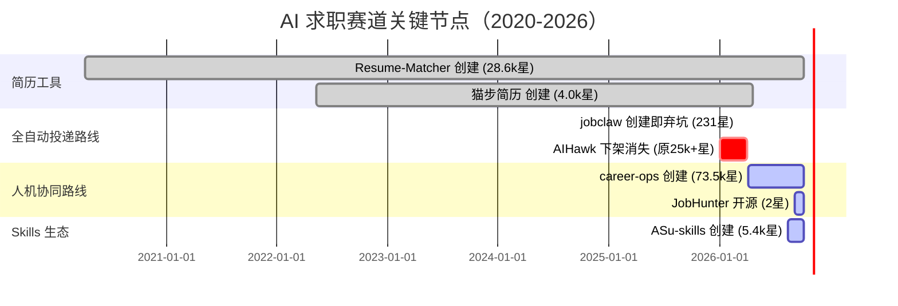
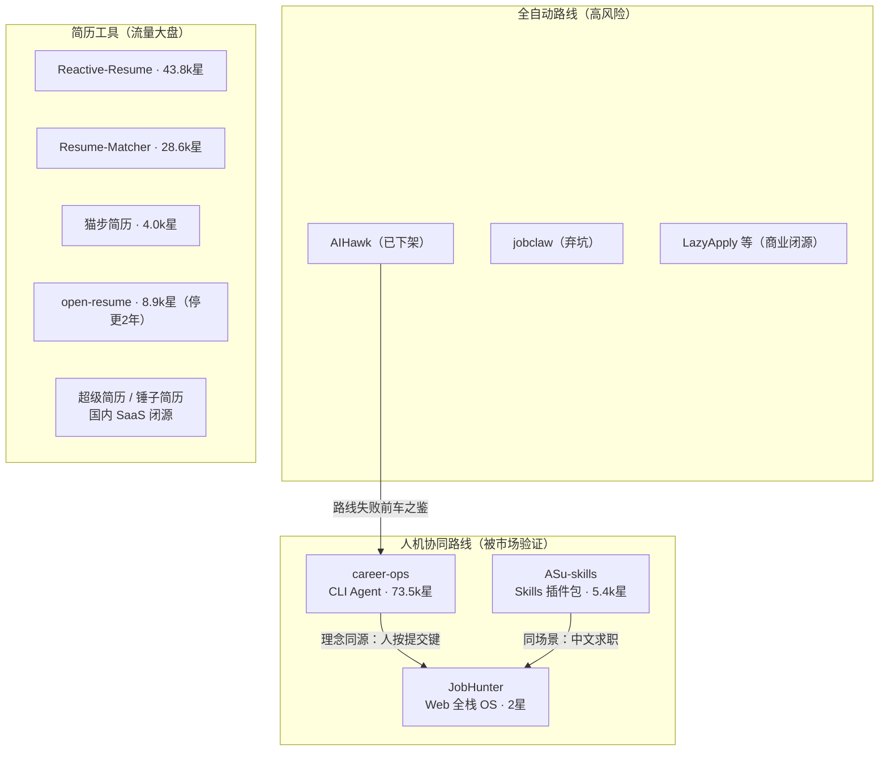

# JobHunter 竞品深度研究报告

- **研究日期：** 2026-10-05
- **时间戳：** 2026-10-05（GitHub API 数据均为当日实时抓取）
- **整体置信度：** 高（核心数据来自 GitHub API 与项目官方 README，一手来源占比 >80%）
- **研究对象：** 开源 AI 求职赛道竞品格局，对照基准为 JobHunter（AI 求职操作系统，D:\text02）

---

## 执行摘要

全球开源 AI 求职赛道在 2026 年完成了一次**形态迁移与头部换血**：全自动投递机器人路线的代表 AIHawk 仓库已下架消失 [citation:GitHub](https://github.com/feder-cr)，其继任者 career-ops 以「CLI Agent + 本地优先 + 用户按下提交键」的人机协同路线，**6 个月内从零冲到 73.5k stars**（2026-04 创建），并获 Business Insider 报道与 Trendshift 日榜第一 [citation:GitHub career-ops](https://github.com/career-ops-hq/career-ops)、[citation:Business Insider](https://www.businessinsider.com/how-i-built-tool-filter-job-listings-landed-head-ai-2026-4)。国内侧，ASu-skills 以 Claude Code 插件包形态做中文求职工作流，**不到 2 个月拿到 5.4k stars** [citation:GitHub ASu-skills](https://github.com/Hisn00w/ASu-skills)。

对照基准 JobHunter（2026-09-05 开源，当前 2 stars [citation:GitHub](https://github.com/ningrix/jobhunter)）：**产品能力密度处于第一梯队，分发渠道处于完全错位状态**。头部竞品全部骑在 AI CLI 生态（Claude Code / OpenCode / skills 市场）的分发红利上，零后端部署门槛；JobHunter 是 20 张表的全栈 Web 系统，安装门槛高一个数量级。差距的核心不是功能多少，而是**入口形态决定了增长斜率**。

---

## 竞争格局总览

### 生态时间线（已核实的创建/失效日期）

### 生态位地图

---

## 竞品档案

### 1. career-ops —— 全球头部，JobHunter 最值得逐项对照的对象

| 维度 | 数据（2026-10-05 GitHub API 实测） |
|---|---|
| 仓库 | career-ops-hq/career-ops |
| Stars / Forks | **73,516 / 13,811** |
| 创建时间 | 2026-04-04（6 个月） |
| 语言 / 协议 | JavaScript / MIT |
| Release 节奏 | 周更（career-ops-v1.35.0 与 web-v0.13.0 同日发版） |
| 贡献者 | santifer 552 commits + 7 名社区成员（69~112 commits） |

**形态**：不是一个 Web 应用，而是一套跑在 AI 编程 CLI 里的 Agent 系统——仓库内含 `.claude` / `.codex-plugin` / `.cursor` / `.kimi` / `.opencode` / `.qwen` / `.grok` 等一整排 CLI 适配目录 [citation:GitHub career-ops](https://github.com/career-ops-hq/career-ops)，外加本地 dashboard（web 组件独立发版）。核心流程：粘贴职位 → 本地判断职位是否还在招、1-5 分匹配打分 → 定制 ATS 友好简历与申请答案 → **用户自己按下提交键**。

**增长引擎拆解**（值得 JobHunter 逐条研究）：
- **创始人叙事**：santifer 自述用这个工具完成自己求职（740 个职位评估 → 68 投递 → 12 面试 → 1 offer），「我是第一个用户，我拿到了工作」[citation:GitHub career-ops](https://github.com/career-ops-hq/career-ops)；
- **媒体报道**：Business Insider 2026-04 报道「I built a tool to filter job listings and landed a head of AI role」[citation:Business Insider](https://www.businessinsider.com/how-i-built-tool-filter-job-listings-landed-head-ai-2026-4)，WIRED（希腊版）跟进 [citation:WIRED](https://wired.com.gr/article/to-ai-ergaleio-pou-fernei-epanastasi-ston-tropou-pou-psachnoume-douleia/)；
- **社会证明机制**：HIRED.md「录用墙」——每个录用故事都是一条公开 issue，用 issue 模板 + 动态 badge 自动计数 [citation:HIRED.md](https://github.com/career-ops-hq/career-ops/blob/main/HIRED.md)；
- **17 种语言 README**、Trendshift 日榜第一 badge、Vercel OSS Program 成员身份；
- **对比页营销**：官网主动做 career-ops vs LazyApply 等竞品对比页承接搜索流量 [citation:career-ops.org](https://career-ops.org/compare/career-ops-vs-lazyapply)。

**商业化**：未发现明确的付费产品，当前处于社区扶持阶段（Vercel OSS Program），变现路径未公开。置信度：中。

**与 JobHunter 的关系**：理念同源（human-in-the-loop、验证码绝不绕过、全链路审计），但形态完全不同——它验证了 JobHunter 选的路线是对的，同时用轻形态吃走了绝大部分流量。

### 2. Resume-Matcher —— 简历侧最老牌 AI 项目，已进化为「AI Harness」

| 维度 | 数据 |
|---|---|
| Stars / Forks | 28,581 / 5,062 [citation:GitHub](https://github.com/srbhr/Resume-Matcher) |
| 创建 | 2020-04-08（6 年老兵，2026 仍在发版：v1.3.0，2026-09-06） |
| 定位演变 | ATS 关键词匹配器 → **「为每次投递定制简历的 AI Harness」**，支持 Claude / ChatGPT / **DeepSeek / Kimi / GLM** 及本地模型 |

**关键信号**：README 明确把国产模型（DeepSeek、Kimi、GLM）写进一句话卖点 [citation:README](https://github.com/srbhr/Resume-Matcher)——JobHunter「AI 网关支持国产模型」的差异化窗口正在被国际竞品覆盖。变现为 GitHub Sponsors + Buy Me a Coffee 捐赠模式，公司赞助位明码标价（"logo in front of 27k+ developers"）。

### 3. ASu-skills —— 国内同赛道最快增长者，形态是 JobHunter 的镜像反面

| 维度 | 数据 |
|---|---|
| Stars / Forks | 5,361 / 301 [citation:GitHub](https://github.com/Hisn00w/ASu-skills) |
| 创建 | 2026-08-12（**<2 个月**） |
| 形态 | Claude Code 插件包，九个独立 skill 入口 |

九入口：`/contributor`（开源贡献）、`/evidence-recap`（AI 编程对话还原证据链）、`/project-guide`（项目导学面经）、`/great-resume`（简历提升）、`/make-resume`（简历制作）、`/interview`（面试准备）、`/offer`（**校招进度管理**）、`/job-match`（岗位匹配）、`/job-apply`（投递填写）。特色是「事实边界」章节——约束简历内容不得超出真实证据，与 JobHunter 的溯源思路不谋而合。

**它证明了什么**：国内求职场景 + AI CLI 生态这个组合，**两个月足够从零到 5k+ stars**；它同时暴露了 JobHunter 没做的场景：校招进度管理、开源贡献养简历、面试题穿透——但按「反对功能追赶」原则，这些是定位参考而非待办清单。

### 4. 次级与外围玩家

- **Reactive-Resume**：43,815⭐，简历构建器品类全球第一，隐私优先、非 AI 原生，持续活跃（当日有提交）[citation:GitHub](https://github.com/AmruthPillai/Reactive-Resume)。它与 JobHunter 只在「简历工作台」一层交叠，属流量大盘参照物。
- **open-resume**：8,909⭐，简历解析+构建，**最后提交 2024-10-29，已停更近两年** [citation:GitHub](https://github.com/xitanggg/open-resume)——纯解析工具护城河太浅的例证。
- **猫步简历（resume-design）**：4,033⭐，Vue3 开源简历制作，在线版 maobucv.com，AI 生成/润色，**2026-04-20 后停更** [citation:GitHub](https://github.com/Hacker233/resume-design)。
- **jobclaw**：231⭐，抓 Boss直聘+LinkedIn → LLM 打分 → 自动打招呼批量投递 → Telegram 汇报，口号「你只管躺平」，**创建当日即停更弃坑** [citation:GitHub](https://github.com/slothsheepking/jobclaw)。它是全自动路线在国内场景的缩影。
- **国内内容型社区**：mianshiya 面试鸭 5,933⭐、AI-Job-Notes 6,168⭐——内容/题库玩法，不与工具型产品直接竞争，但占据「求职」关键词心智 [citation:GitHub](https://github.com/liyupi/mianshiya)、[citation:GitHub](https://github.com/amusi/AI-Job-Notes)。

### 5. AIHawk 之死——全自动路线的路线级判例

原仓库 feder-crud/Auto_Jobs_Applier_AIHawk（鼎盛期 25k+ stars 的 LinkedIn 自动投递机器人）现已 **404 不可访问**，镜像仓库散落存续（如 11844/Auto_Jobs_Applier_AIHawk）[citation:mirror](https://github.com/11844/Auto_Jobs_Applier_AIHawk)。**未检索到 DMCA 下架记录**，作者 feder-cr 转向 `invisible_playwright`（2.9k⭐，C++ 源码级反指纹检测的 Playwright）[citation:GitHub profile](https://github.com/feder-cr)——从「求职产品」退回「隐身自动化军火库」。下架原因置信度：中低（仓库消失为事实，原因仅可推测为平台对抗/合规压力）。**结论：全自动投递路线在头部平台面前不可持续，这是整条赛道用真实项目换来的判例。**

### 6. 国内商业化锚点（闭源 SaaS）

- **超级简历 WonderCV**：宣称 3,000 万+ 用户、GGV/愉悦资本投资；Freemium 模式，会员约 ¥39.9/¥69.9，终身会员 ¥98；免费版导出带水印，用户对「导出强制付费」吐槽集中 [citation:WonderCV](https://www.wondercv.com)、[citation:什么值得买](https://post.smzdm.com)；
- **锤子简历**：终身会员 ¥49.9，整合证件照、面试计时器等周边工具 [citation:什么值得买](https://post.smzdm.com)；
- 行业价格锚点：**终身会员普遍 ¥50-100，月付 ¥10-50**。结论：国内简历工具付费意愿存在但客单极低，「模板+导出付费墙」是红海且口碑反噬——JobHunter 不应进入这个价格带竞争。

---

## 功能对比矩阵

| 维度 | **JobHunter** | career-ops | Resume-Matcher | ASu-skills | 国内 SaaS（超级简历类） |
|---|---|---|---|---|---|
| 形态 | Web 全栈 OS | CLI Agent + 本地 dashboard | Web 应用（本地/自托管） | Skills 插件包 | 闭源 SaaS |
| 部署门槛 | npm+DB+seed（高） | 装个 skill 即用（极低） | 低（支持 100+ LLM） | 极低 | 零（注册即用） |
| 职位采集 | 引导式人工导入+适配器架构 | 扫描 job boards 自动评估 | 无（用户粘贴） | 无（用户粘贴） | 无 |
| 匹配评分 | 五维规则+权重向量+AI 解读 | 1-5 分评估报告 | 简历-JD 相似度 | /job-match | 基础 JD 匹配 |
| 简历 AI | 结构化+诊断评分+溯源 | 定制 CV+申请答案 | 核心（AI Harness） | 生成/提升/证据链 | 生成/润色（付费墙） |
| 投递自动化 | L1 半自动+安全状态机+审计 | 用户按提交键（同理念） | 无 | 填写辅助 | 无 |
| 国内平台 | Boss/大厂导航（合规） | 无 | 无 | 校招流程 | 无（产品即国内） |
| 国产模型 | GLM/DeepSeek/Kimi/Qwen | 依赖所用 CLI | DeepSeek/Kimi/GLM | 依赖 Claude Code | 自有 |
| 数据资产 | 20 表持久化+成本核算 | 本地文件 | 本地 | 本地 markdown | 云端（锁平台） |
| Stars | 2 | 73,516 | 28,581 | 5,361 | 商业保密 |
| 增长斜率 | — | ~1.2万/月 | ~5千/月（重发布期） | ~3千/月 | — |

---

## 差距分析（直指问题，不列优点）

1. **分发形态错位是第一差距，且与产品质量无关。** career-ops 和 ASu-skills 的共同点不是功能强，而是**入口骑在 AI CLI 生态上**：装一个 skill/plugin 即用，用户在已经打开的 Claude Code 里被激活。JobHunter 的入口是「clone → npm install → db:seed → npm run dev」，哪怕有 Codespaces 一键化，仍比装 skill 重一个数量级。**用户增长瓶颈在入口重量，不在功能清单长度。**

2. **社会证明体系为零。** career-ops 的 HIRED.md 录用墙（公开 issue + 自动计数 badge）、媒体报道页、17 语言 README、周更 Release note，全是**零开发成本**的运营机制；JobHunter 当前 README 有设计感但没有任何「用户用它拿到了 offer」的证据链。2 stars 的项目讲不出成功率故事，也没建收集故事的机制。

3. **发布节奏与版本叙事缺失。** 对比对象全部保持周更/双周更 Release 并给版本命名（career-ops-v1.35.0、Resume-Matcher v1.3 "Crescendolls"），JobHunter 开源一个月只有一次提交，V3.3→V4.0 的迭代全部沉淀在本地未推送——**外部世界看到的仓库状态停留在 2026-09-06**。

4. **采集能力的合规路线没有转化成叙事优势。** 竞品「扫描职位板自动评分」的爽点闭环更完整，但 AIHawk/jobclaw 的下场说明自动抓取不可持续；JobHunter 的「引导式导入+三级去重+大厂官方导航」是更可持续的路线，**却没有像 career-ops vs LazyApply 那样主动做对比页，把合规优势翻译成搜索流量**。

5. **「支持国产模型」差异化窗口正在收窄。** Resume-Matcher 已把 DeepSeek/Kimi/GLM 写进一句话卖点；JobHunter 的 AI 网关（加密存储、日限额、成本计量）技术上更深，但**技术深度不构成用户可感知的差异**，需要产品化成卖点（例如「一份简历 0 元跑通全流程」的确定性承诺）。

6. **商业化在两条路线间摇摆且都未落地。** 国内 C 端价格锚（终身 ¥50-100）撑不起一个 OS 级产品；career-ops/ASu-skills 则根本没变现——**开源头部项目证明了增长可以爆发，但没人证明这个赛道能赚钱**。JobHunter 的成本计量基建（ai-usage）是为数不多指向「按用量收费」的能力，但没有包装成商业模式。

---

## 战略含义（定位与渠道，非功能清单）

1. **借船出海，不自建流量**：把 JobHunter 的领域能力（JD 解析、五维评分、差距分析、投递看板）反向封装成 Claude Code / OpenCode 的 skills 包，作为 CLI 入口引流，Web OS 承接深度使用——ASu-skills 用两个月验证了这条通道在国内的增长斜率。这复用现有代码而非重写。
2. **立刻零成本抄社会证明机制**：录用墙 issue 模板 + badge、Release 节奏、双语 README——先让仓库「看起来活着」。
3. **合规路线主动做对比页**：学习 career-ops vs LazyApply，做「半自动 vs 全自动（封号风险）」「持久化 OS vs 一次性工具」的对比内容承接搜索。
4. **商业化避开简历模板红海**：C 端终身 ¥50-100 的价格带不值得进入；按 AI 用量计费（基建已有）或 B 端（高校就业中心、培训机构批量部署）是更匹配 OS 形态的方向。
5. **坚持 L1 人机协同并高举高打**：career-ops 的 73k stars 是对「用户按提交键」路线的市场验证，JobHunter 的安全状态机+审计留痕在该路线上走得更深，应作为定位声明而非隐藏实现。

---

## 来源

### 一手来源（GitHub API，2026-10-05 实测）
- [career-ops-hq/career-ops](https://github.com/career-ops-hq/career-ops) · [HIRED.md](https://github.com/career-ops-hq/career-ops/blob/main/HIRED.md) · [Releases](https://github.com/career-ops-hq/career-ops/releases)
- [srbhr/Resume-Matcher](https://github.com/srbhr/Resume-Matcher) · [Hisn00w/ASu-skills](https://github.com/Hisn00w/ASu-skills) · [AmruthPillai/Reactive-Resume](https://github.com/AmruthPillai/Reactive-Resume)
- [Hacker233/resume-design](https://github.com/Hacker233/resume-design) · [xitanggg/open-resume](https://github.com/xitanggg/open-resume) · [slothsheepking/jobclaw](https://github.com/slothsheepking/jobclaw)
- [liyupi/mianshiya](https://github.com/liyupi/mianshiya) · [amusi/AI-Job-Notes](https://github.com/amusi/AI-Job-Notes) · [ningrix/jobhunter](https://github.com/ningrix/jobhunter)
- AIHawk 镜像：[11844/Auto_Jobs_Applier_AIHawk](https://github.com/11844/Auto_Jobs_Applier_AIHawk) · 作者主页：[feder-cr](https://github.com/feder-cr)

### 媒体与社区
- [Business Insider：How I built a tool to filter job listings and landed a head of AI role](https://www.businessinsider.com/how-i-built-tool-filter-job-listings-landed-head-ai-2026-4)
- [WIRED（希腊版）报道](https://wired.com.gr/article/to-ai-ergaleio-pou-fernei-epanastasi-ston-tropou-pou-psachnoume-douleia/)
- [Trendshift：career-ops 日榜第一](https://trendshift.io/repositories/25195) · [Trendshift：ASu-skills](https://trendshift.io/repositories/139058)

### 商业化参考
- [超级简历 WonderCV 官网](https://www.wondercv.com) · [什么值得买：简历制作网站横评](https://post.smzdm.com)
- [career-ops.org 对比页（vs LazyApply）](https://career-ops.org/compare/career-ops-vs-lazyapply)

---

## 置信度评估

**高置信（90%+）：**
- 所有 stars/forks/创建时间/停更时间/Release 节奏/贡献者数据（GitHub API 当日实测）
- career-ops、ASu-skills、Resume-Matcher 的形态与功能描述（官方 README 一手来源）
- AIHawk 仓库已不可访问、镜像存续（直接验证）
- JobHunter 基线数据 2⭐（GitHub API 实测）

**中置信（70-89%）：**
- 国内 SaaS 定价细节（来自官网与电商页面聚合，价格可能随时调整）
- AIHawk 增长期星数「25k+」（来自检索快照与报道，无法在原仓库复核）
- career-ops 未变现的判断（基于公开信息 absence of evidence）

**低置信（50-69%）：**
- AIHawk 下架的具体原因（无 DMCA 记录证实，仅为基于作者行为轨迹的推断）
- jobclaw「弃坑」的定性（客观事实是创建当日停更，动机未知）

---

## 研究方法论

1. **GitHub REST API（gh CLI 认证通道）**：对 12+ 仓库抓取 metadata、README、releases、contributors、contents 目录树；`search/repositories` 按关键词×stars 排序扫描赛道全景（auto apply jobs / AI job search agent / resume matcher / 求职 AI）
2. **多轮网络搜索**：竞品发现 → career-ops 商业化核实 → AIHawk 下架事件核实 → 国内 SaaS 定价核实
3. **交叉验证**：GitHub API 数据与 README 自述、媒体报道三角核对；无法复核的数值降级标注
4. **时间线重建**：以仓库 created_at / pushed_at / release 时间戳为骨架
5. **研究深度**：竞品格局扫描 + 头部 3 家深挖 + 外围 5 家速写
6. **范围**：时间 2020-04 ~ 2026-10；地域 全球 GitHub + 中国市场；工具 github-deep-research skill 四轮流程（GitHub API → Discovery → Deep Investigation → Deep Dive）

---

**报告生成：** github-deep-research（DeerFlow 方法论）× ZCode
**日期：** 2026-10-05 · **版本：** 1.0 · **状态：** 完成
